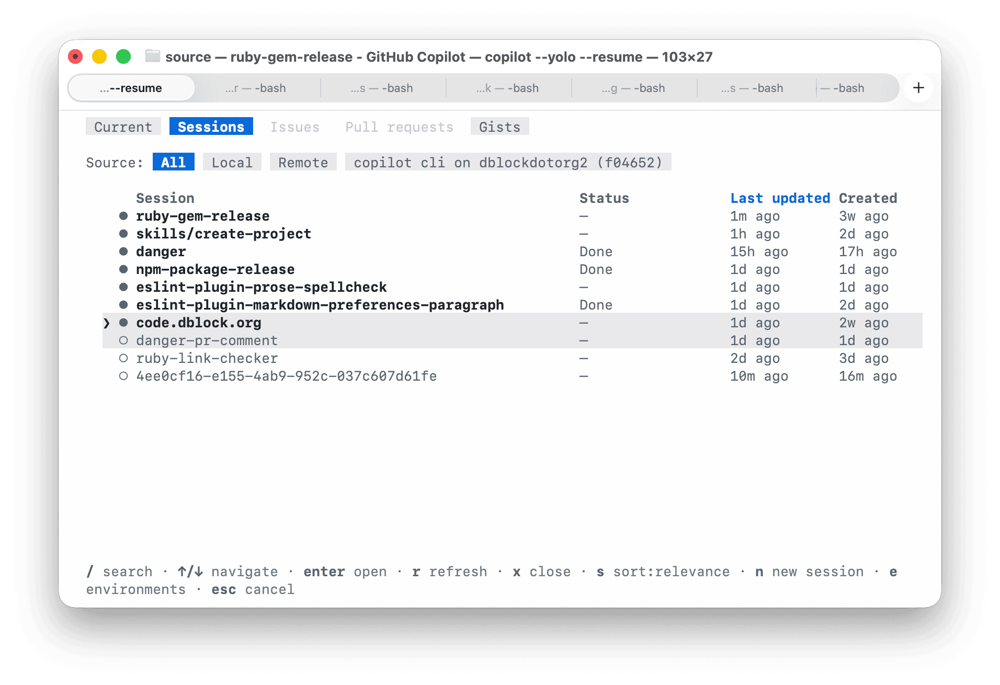

I recently [built a Markdown linter with GitHub Copilot CLI](/2026/11/06/linting-both-prose-and-embedded-code-with-rubocop.html). In between, I reviewed other projects, edited this blog, and generally treated one conversation as a terminal into which I could dump whatever I was doing next. I really loved the fact that Copilot would context switch, do some work, then go back to what it was doing. It's so smart!

Well, that may have burnt some extra tokens.

### Counting Tokens

The local usage logs for the roughly three-and-a-half-day development window showed approximately 4,322 model calls, including delegated agents:

| Token Type       | Millions |
| ----------       | -------- |
| Non-cached input | 11.4     |
| Output           | 2.4      |
| Cached input     | 411      |

That's roughly 14 million non-cached input and output tokens, plus more than 400 million cached input tokens.

Cached input is previously processed context reused across requests. The same context can be counted repeatedly, so 411 million doesn't mean I wrote 411 million tokens or that Copilot generated that much code. It also doesn't translate directly into dollar spend: cached input has different accounting from non-cached input and output. Still, I had given it a lot of unrelated history to carry around and wasted a lot of time waiting for it to restore and save context.

### Start a Session, Give It a Name

Since then, I've been using [Copilot CLI](https://docs.github.com/copilot/how-tos/copilot-cli)'s named sessions more. Here's the workflow that is working for me.

My source code lives in `~/source`. I group related projects together, keeping my forks and upstream checkouts in the same folder. Git working trees fit into the same layout, named after the project and task. For example, here's how I'd add task-specific working trees alongside my fork of [ESLint's Markdown plugin](https://github.com/eslint/markdown) and its upstream checkout:

```text
~/source/
`-- eslint/
    `-- markdown/
        |-- upstream-markdown/           # upstream checkout
        |-- dblock-markdown/             # my fork
        |-- dblock-markdown-parser-fix/  # working tree
        `-- dblock-markdown-docs/        # working tree
```

I start a single `copilot` process in `~/source` and switch between sessions inside it.

```sh
cd ~/source
copilot --yolo --resume
```

Inside an interactive session, I open the session picker with `/resume`, create new sessions with `n`, and name them after the repository with `/rename`. I use `/cwd` to change each session's working directory to the project checkout. Naming a session doesn't change its directory, but Copilot has gotten used to my source code layout by now.

Here's how it looks.


