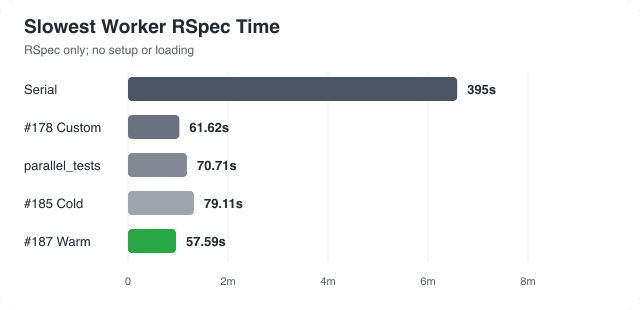

Running RSpec on eight workers got [Posebook](https://github.com/dblock/posebook), a custom Rails CMS, from more than six minutes of RSpec time to about one using [`parallel_tests-ci`](https://github.com/dblock/parallel_tests-ci) that I built to adjust shards automatically as tests get faster or slower, without repeating the GitHub Actions boilerplate for splitting files, running workers, and passing timings between runs.

### Posebook Benchmarks

Each bar shows the slowest worker's RSpec execution time, excluding setup and spec loading. The [serial run](https://github.com/dblock/posebook/actions/runs/44218105420) took 395 seconds. With eight workers, every run shown took less than 80 seconds of RSpec time. Sharding improved further capturing data from previous runs.



### How to Use It

With Ruby 3.3 or newer, add the gem to your `Gemfile` and run `bundle install`:

```ruby
gem 'parallel_tests-ci', '0.1.0', require: false
```

In `.github/workflows/test.yml`, call the reusable workflow at the same version:

```yaml
name: Test
on: [push, pull_request]

permissions:
  contents: read
  actions: read

jobs:
  test:
    uses: dblock/parallel_tests-ci/.github/workflows/rspec.yml@v0.1.0
    with:
      shards: 8
```

If your specs need a database or other setup, use the workflow's [`setup` input](https://github.com/dblock/parallel_tests-ci/tree/v0.1.0#suite-and-setup) to run those commands on each worker.

### How It Works

Without timing history, [`parallel_tests`](https://github.com/grosser/parallel_tests) groups spec files by size. After a [successful run triggered by a push to the default branch](https://github.com/dblock/posebook/actions/runs/44401742212), the workflow saves per-file timings in a [`runtime.log`](/downloads/posts/2026-11-19-automatic-rspec-sharding-on-github-actions/posebook-runtime.log) and uploads it as a GitHub Actions artifact. Before splitting the suite, later runs look for that artifact in recent successful runs of the same workflow on the default branch. They download the newest one still available and use its timings to give each worker roughly the same amount of work. Pull requests can also download the artifact, but cannot update the timing history.
