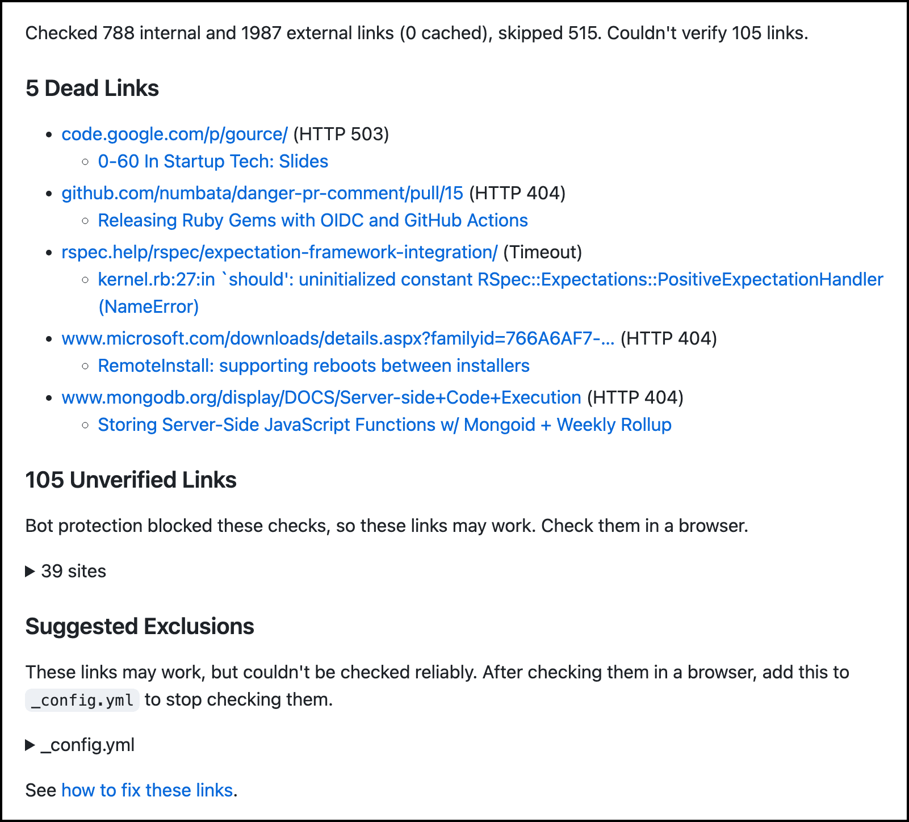

Most of my Jekyll blogs, including this one, used [html-proofer](https://github.com/gjtorikian/html-proofer) from a `rake check` task that I ran by hand, which means I never ran it. I swapped that for a faster [ruby-link-checker](https://github.com/dblock/ruby-link-checker), and ran it in CI, piling broken links into a GitHub issue that I never looked at. Finally, I made [jekyll-ruby-link-checker](https://github.com/dblock/jekyll-ruby-link-checker) and got a hold of the broken links problem with some AI help.

### A New Jekyll Plugin

<a href="https://github.com/dblock/jekyll-ruby-link-checker"></a> <a href="https://github.com/dblock/ruby-link-checker"></a>

The new [jekyll-ruby-link-checker](https://github.com/dblock/jekyll-ruby-link-checker) is a Jekyll plugin that checks links during the build, with a cache and two reusable GitHub workflows that comment on pull requests and keep a "Broken Links" issue up to date.

### What It Does

The plugin uses [ruby-link-checker](https://github.com/dblock/ruby-link-checker) for external links, and runs at the end of the Jekyll build, checking 5 external links at a time. It only runs when `LINK_CHECKER` is set, so `jekyll serve` and the build that deploys the site stay fast.

```sh
LINK_CHECKER=1 bundle exec jekyll build
```

```text
LinkChecker: Checked 1 internal and 2 external links (0 cached), skipped 0.
LinkChecker: Found 2 dead links: /missing/ (page not found), linked from _posts/2026-11-23-hello.md https://github.com/dblock/this-does-not-exist-xyz (HTTP 404), linked from _posts/2026-11-23-hello.md
```

It checks links, anchors, images, scripts, stylesheets, video, audio, and iframes, in posts and pages and in layouts and includes, and reports each dead one against the source file that links to it. Sites that answer with 401, 403, 429, 999, or a Cloudflare challenge are reported as _unverified_ and don't fail the build: the page probably exists, a bot just isn't allowed to see it. The first run without a cache checks every external link and is slow, about 3 minutes for this blog; after that, most links come from the cache, and the check takes seconds. Working links are cached for 30 days and unverified ones for 7.

On GitHub, `check-links.yml` builds the site with read-only permissions, so it's safe on pull requests from forks, and pull requests only check the pages they change. A second workflow, `publish-report.yml`, runs after it to comment on pull requests and keep an issue up to date on the default branch, closing it when everything works. Here's the first report from this blog.



The reusable workflows abstract all the complexity of saving and restoring the cache across runs. Runs on the default branch save their dead links in the Actions cache, and pull requests only fail on _new_ ones. The report lists new, existing, and fixed links separately, so you can keep fixing old links at your own pace while every pull request is still checked.

The report also suggests exclusions: a `_config.yml` snippet with every site and URL it couldn't check reliably, to paste after looking at them in a browser.


I didn't take most of them since unverified links don't fail the build. These are more useful for the 2,800 GitHub "edit this page" or Twitter's 3,100 share links.

### AI Fixes Links

A report of dead links is a to-do list, and fixing links is exactly the kind of tedious work I want to hand off. For each dead link, Claude looked for where the content went, made the change, and ran the checker again until it reported 0 dead links.

- Moved repositories: GitHub redirects a moved repository, but not always the links inside it, and not once a fork takes the old name. For example, `docker-machine` is now in [docker-archive-public](https://github.com/docker-archive-public/docker.machine/issues/1946), and `danger-pr-comment` moved to the [danger](https://github.com/danger/danger-pr-comment/pull/15) organization.
- Moved projects: Gource left Google Code for [gource.io](https://gource.io/), and the RSpec docs moved to [rspec.info](https://rspec.info/).
- Pages that no longer exist, such as a Visual Studio 2005 download from Microsoft and the old MongoDB wiki, point to their Wayback Machine snapshots, found with the archive's availability API.
- Images that are gone from their sites were saved from the Wayback Machine into `images/posts/`, so they can't disappear again.

### Real-World Walkthrough

I implemented a link checker on [run.dblock.org](https://run.dblock.org).

In [#56](https://github.com/dblock/run.dblock.org/pull/56) I replaced `html-proofer` with the plugin, configured under `link_checker` in `_config.yml`. It excluded the Facebook and Twitter share links and the GitHub "edit this page" link on every post, about 3,100 links that need an account. Checking layouts immediately found two dead references that html-proofer never complained about: a Markdown `alternate` link on the `/photos/` redirect page, which has no Markdown version, and a script on the 404 page from Google's discontinued link help service.

[The first run on `gh-pages`](https://github.com/dblock/run.dblock.org/actions/runs/45248799938) checked 5,279 internal and 2,532 external links, including Strava's photo CDN, and found 25 dead links, all in 2018 posts: pages that moved, shops that closed, and nyrr.org redirect loops. The Publish Link Checker Report workflow opened [#59](https://github.com/dblock/run.dblock.org/issues/59) with all of them.


Then [#60](https://github.com/dblock/run.dblock.org/pull/60) fixed links to a post I had renamed. Its check only looked at the 2 pages it changed, compared them with the dead links that `gh-pages` had saved, reported "5 dead links already existed, 1 link fixed", and passed.


### Setup

Point your AI to this post or [jekyll-ruby-link-checker](https://github.com/dblock/jekyll-ruby-link-checker). It will set everything up for you and fix your broken links.
