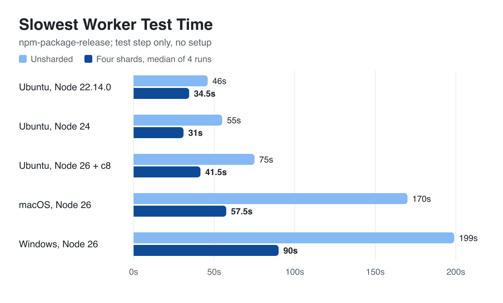

Last week I wrote about [automatic RSpec sharding on GitHub Actions](/2026/11/19/automatic-rspec-sharding-on-github-actions.html) with [`parallel_tests-ci`](https://github.com/dblock/parallel_tests-ci), a Ruby project. Claude ported this approach to JavaScript and we called it [testlanes](https://github.com/dblock/testlanes). It splits Vitest, Jest, and node:test suites into shards balanced by how long each test file took in earlier runs, on Linux, macOS, and Windows.

<a href="https://github.com/dblock/testlanes"></a>

### Real Project Benchmarks

The tests of [npm-package-release](https://github.com/dblock/npm-package-release) took more than three minutes on Windows and almost as long on macOS. Each bar shows the slowest worker's test step in one of the five Test environments, excluding setup. The [unsharded run](https://github.com/dblock/npm-package-release/actions/runs/45908637236) took 199 seconds on Windows and 170 seconds on macOS. I then ran the same pull request four times with four shards per environment, balanced by timings recorded before the split. The slowest worker took 27 to 48 seconds on Ubuntu, 57 to 58 seconds on macOS, and 74 to 110 seconds on Windows, whose runners vary the most from run to run.



### How to Use It

With Node.js 22.12 or newer, add testlanes as a development dependency:

```sh
npm install --save-dev testlanes@0.3.0
```

In `.github/workflows/test.yml`, call the reusable workflow at the same version and set `framework` to `vitest`, `jest`, or `node` for node:test:

```yaml
name: Test
on: [push, pull_request]

permissions:
  contents: read
  actions: read

jobs:
  test:
    uses: dblock/testlanes/.github/workflows/testlanes.yml@v0.3.0
    with:
      framework: node
      shards: 4
```

Use `runs-on` to pick Linux, macOS, or Windows, and the workflow's `setup`, `install-node-version`, `test-wrapper`, and `artifacts` [inputs](https://github.com/dblock/testlanes/tree/v0.3.0#configuration) to build before testing, install with a different Node.js than you test with, or collect coverage from every shard. The [npm-package-release Test workflow](https://github.com/dblock/npm-package-release/blob/master/.github/workflows/test.yml) runs all five environments as one matrix and sends every shard's coverage to Coveralls.

### How It Works

Without timing history, testlanes groups test files by size. Each shard runs its files with a small timing reporter for Vitest, Jest, or node:test. After a successful run triggered by a push to the default branch, the workflow combines the shards' per-file timings into a [`timings.json`](/downloads/posts/2026-11-26-automatic-javascript-test-sharding-on-github-actions/npm-package-release-timings.json) and uploads it as a GitHub Actions artifact. Later runs look for that artifact once, in recent successful runs of the same workflow on the default branch, and every shard downloads it and computes the same plan, giving each shard roughly the same amount of work; a final job checks that all shards agreed on the plan. Pull requests can also download the artifact, but cannot update the timing history.

Ruby has [`parallel_tests`](https://github.com/grosser/parallel_tests) to do the splitting. I found nothing maintained for JavaScript, so testlanes does it itself, assigning the heaviest file to the lightest shard until every file has a place. The reusable workflow's own steps run JavaScript with [`actions/github-script`](https://github.com/actions/github-script), so they need no shell and behave the same on Linux, macOS, and Windows; only your `install-command` and `setup` scripts run in the runner's default shell.

The test step is only part of the bill. Every shard checks out the code and installs dependencies, so with testlanes 0.2.0 the whole Test workflow took about as long as [the unsharded run](https://github.com/dblock/npm-package-release/actions/runs/45908637236) and used more than twice the runner time. testlanes 0.3.0 [drops the separate planning job](https://github.com/dblock/testlanes/pull/21), which cut the whole workflow from 380 to 261 seconds across [four runs of each](https://github.com/dblock/testlanes/pull/21#issuecomment-7222224999).
